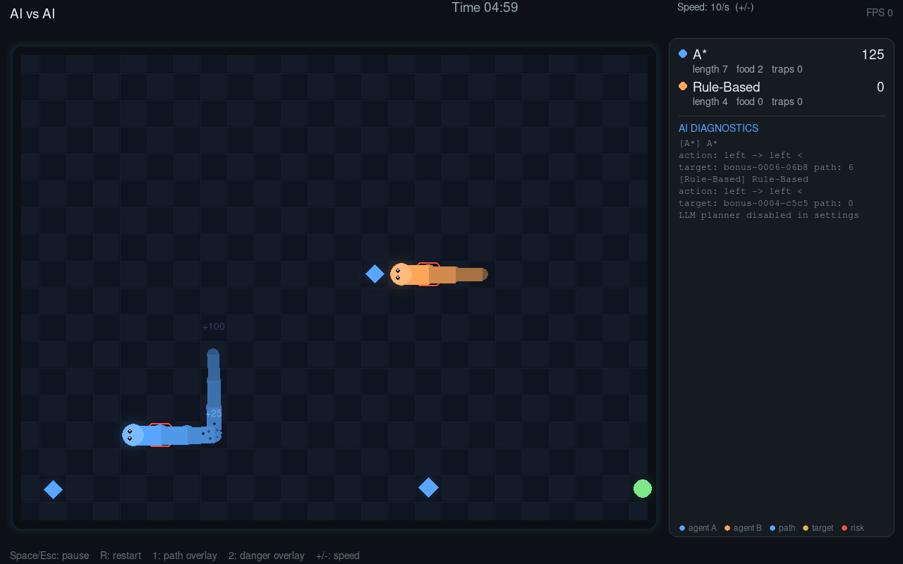
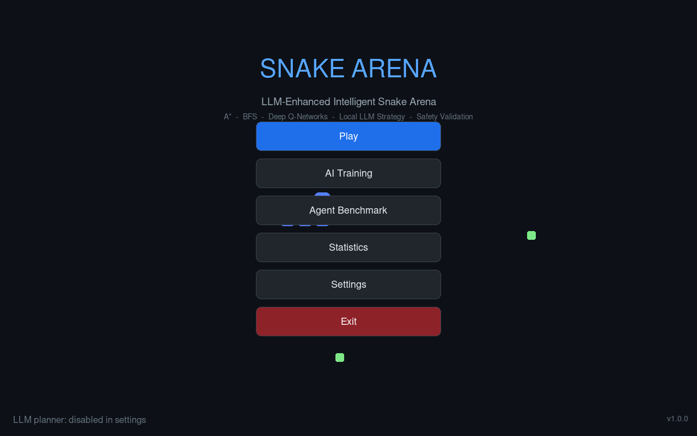

# LLM-Enhanced Intelligent Snake Arena

[](https://github.com/jahinhasan/Snake-game/actions/workflows/ci.yml)

A polished, research-grade Snake game where classical search agents, a PyTorch
DQN, and an optional locally-hosted LLM strategic planner (Ollama) play on the
same grid — every AI action passes through an independent safety validator
before it moves a pixel.

Built as an academic project: real algorithms, honest reporting (untrained
networks are labelled as such; LLM fallback is labelled as fallback), and
benchmark artifacts (JSON/CSV/PNG) generated from actual runs, never typed in
by hand.

| Gameplay (AI vs AI) | Menu |
| --- | --- |
|  |  |

---

## Features

**Game**
- Simultaneous-turn grid arena (default 24×18, configurable 10×10 – 40×30),
  wall / self / opponent collisions, head-on collisions eliminate both snakes.
- 5 food types with spawn probabilities, lifetimes, risk tiers, and scoring:
  normal (+10, 55%), bonus (+25, 20%), golden (+50, 13%), special (+100, 7%,
  grows 2 segments), trap (−20, 5%).
- Modes: human vs AI, AI vs AI, and a round-robin tournament runner.
- Pause, restart, speed slider, seed control, keyboard controls
  (arrows / WASD, Space = pause).
- Polished rendering: smoothly interpolated snake bodies with gradients,
  glow + pulse effects, particle bursts, floating score popups, screen shake,
  screen fade transitions — all pure pygame, no image assets.

**AI**
- **Rule-based** — weighted heuristics (food value, distance, danger, trap
  avoidance).
- **BFS** — shortest safe path to the best food.
- **A\*** — optimal pathing with flood-fill dead-end avoidance.
- **DQN (PyTorch)** — 30→128→128→4 MLP, Double DQN, Huber loss, epsilon-greedy
  1.0 → 0.05; honest about being untrained until it is actually trained.
- **LLM planner** — a local LLM (Ollama, default `qwen3:4b`) issues strategic
  postures (greedy / balanced / defensive / survival, food target, risk
  tolerance) every few seconds. It never blocks the game loop: cached,
  rate-limited, background-threaded, with a deterministic fallback strategy
  when the server is absent or slow. On low-RAM machines the client
  **auto-falls back to smaller models**: if `qwen3:4b` is not installed it
  tries `qwen3:1.7b`, then `qwen3:0.6b` (configurable via
  `llm.fallback_models`), then any other installed `qwen3` tag — and the
  arena diagnostics show which model actually answered.
- **Hybrid** — LLM posture modulates the weights between A\* and DQN votes;
  documented deterministic arbitration.
- **Safety checker (mandatory)** — every proposed action from every agent is
  independently validated (wall, reversal, self, opponent, dead-end
  flood-fill) and overridden with the best safe alternative. Interventions are
  counted and displayed.

**UI (7 screens)**
Menu (with a live AI game playing dimmed in the background) · Mode select ·
Arena (with AI diagnostics overlays: chosen path, danger zones, target,
rejected moves, live Q-values) · RL training dashboard · Benchmark dashboard
(solo runs + tournaments, progress bar, cancellable) · Settings · Statistics
& history.

**Evaluation**
- Identical per-index seeds across agents, so score differences are policy
  differences, not luck.
- Artifacts per run: `results.json`, `summary.csv`, `records.csv`, and score /
  survival / food-type charts. A reference benchmark session (7 agents × 20
  episodes) and the trained checkpoint ship with the repo under
  `data/benchmarks/` and `models/`.
- Post-game LLM analysis (clearly marked as model-generated) when Ollama is
  available; a deterministic summary otherwise.

**Reliability**
- Atomic config/history saves with corrupt-file quarantine and recovery.
- The game runs fully without Ollama — LLM off is the default configuration.
- 112 automated tests (engine, food, pathfinding, safety, RL, LLM client with
  a fake transport, decision manager, benchmark, persistence, integration,
  headless UI smoke tests): `pytest` passes with no network and no Ollama.
- CI (GitHub Actions) runs the suite + ruff on Python 3.11–3.14 (Linux) and
  3.14 (Windows) with CPU-only torch.

---

## Requirements

- Python **3.11+** (developed and tested on **3.14**)
- CPU is sufficient for everything; CUDA torch works automatically if present
- Optional: [Ollama](https://ollama.com) with `ollama pull qwen3:4b`

This project uses **pygame-ce** (the community-maintained drop-in for pygame,
imported as `import pygame`) because it ships prebuilt wheels for current
Python versions where classic pygame may not.

## Quick start (Arch Linux / any Linux / macOS)

```bash
./setup_linux.sh     # creates .venv, installs CPU torch + requirements
./run_linux.sh       # or: .venv/bin/python main.py
```

CLI tools:

```bash
.venv/bin/python main.py --check          # environment self-test (no window)
.venv/bin/python main.py --train 400      # headless DQN training
.venv/bin/python main.py --benchmark 20   # headless benchmark, all agents
.venv/bin/python main.py --benchmark 10 --agents rule_based,astar
.venv/bin/python main.py --no-llm         # force the LLM planner off
```

Artifacts land in `data/benchmarks/<run-id>/` and `data/training/`;
checkpoints in `models/`.

## Windows

**One file is enough:** on a fresh clone, double-click `run_windows.bat` —
it installs Python (via winget, if missing), creates `.venv`, downloads all
dependencies, installs Ollama + pulls a qwen3 model **sized to the machine's
RAM** (0.6b / 1.7b / 4b), and starts the game. See
[docs/WINDOWS_SETUP.md](docs/WINDOWS_SETUP.md) for the manual equivalent.
**Honest disclosure:** these scripts were authored for Windows but this
project was developed and tested on Arch Linux only — the Windows path has
not been executed on real Windows hardware (the test suite itself *is*
exercised on Windows by CI).

## Enabling the LLM planner

```bash
ollama serve                     # if not already running as a service
ollama pull qwen3:4b
```

**Low-RAM machine?** You don't need the big model. Pull any one of them and
the game adapts automatically:

```bash
ollama pull qwen3:0.6b           # ~0.5 GB download; runs in well under 1 GB RAM
```

The client asks the server for installed tags before the first inference and
picks the best available model: `llm.model` (`qwen3:4b`) first, then the
`llm.fallback_models` chain (`["qwen3:1.7b", "qwen3:0.6b"]` by default), then
any other installed `qwen3:*` tag. The switch is announced in the arena's AI
diagnostics (`llm note: requested 'qwen3:4b' is not installed; using smaller
fallback 'qwen3:0.6b'`), so nothing happens silently.

Then either set `llm.enabled = true` in Settings (or `config/default.json`),
or set the environment variable `SNAKE_ARENA_LLM=1` style overrides — the
simplest path is the Settings screen: *LLM Planner → enabled → Save*. If the
server or model is missing, agents silently use the documented deterministic
fallback and diagnostics show `strategy_source: fallback`; nothing crashes and
nothing is fabricated.

---

## Project layout

```
main.py                  entry point (UI by default; --check/--train/--benchmark)
config/default.json      validated, self-healing configuration
config/foods.json        food-type catalog
scripts/                 check_environment, train, benchmark CLIs
src/snake_arena/
  game/                  engine, state, snake, collision, food, RL environment
  agents/                rule_based, bfs, astar, rl_agent, decision_manager, factory
  llm/                   ollama_client, strategist (prompts, snapshot, fallback), schemas, analysis
  safety/                independent action validator
  rl/                    network, trainer, rewards, checkpoints
  evaluation/            benchmark runner, metrics, experiment artifacts
  persistence/           atomic storage, game history
  ui/                    app shell + 7 screens, widgets, theme, effects
  utils/                 paths, logging helpers
tests/                   112 tests, fully offline
docs/                    architecture, algorithms, RL guide, experiments, Windows setup, report
```

## Tests

```bash
.venv/bin/python -m pytest tests/ -q
```

Measured on the development machine: **112 passed** in ~9 s, no network, no
GPU, no Ollama required.

## Documentation

- [docs/ARCHITECTURE.md](docs/ARCHITECTURE.md) — modules, data flow, threading
- [docs/AI_ALGORITHMS.md](docs/AI_ALGORITHMS.md) — each agent + safety layer + LLM protocol
- [docs/RL_TRAINING.md](docs/RL_TRAINING.md) — network, rewards, training recipe
- [docs/EXPERIMENTS.md](docs/EXPERIMENTS.md) — methodology + how to reproduce
- [docs/REPORT.md](docs/REPORT.md) — academic write-up (abstract → limitations → future work)

## Known limitations (honest list)

- The shipped DQN checkpoint was trained for **640 episodes** on CPU — it is
  competitive with the search agents in the reference benchmark (mean score
  2275 vs A\* 2113, BFS 2095; hybrid 2466 leads), but it is not converged;
  longer training is one command away and is reported honestly by the tooling.
- The LLM path was verified with a programmable fake transport + fallback
  logic; the reference benchmark ran with `llm_available: false`, so no
  LLM-generated gameplay is included in those numbers.
- **Windows scripts are untested on real hardware** (development happened on
  Arch Linux; CI covers the Python code on `windows-latest`).
- Single machine, local-only: no networking, no accounts.
